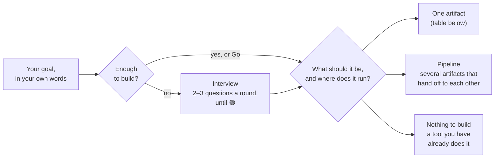

# FLIP Prompt Architect

A Claude skill that turns a rough idea into a deployed AI system. It interviews you first, picks the right artifact class, and won't build the wrong thing.

You describe the goal. The framework decides whether the answer is a one-shot prompt, a persistent assistant, a skill, a multi-prompt pipeline, a build brief for a coding agent, or nothing at all because a tool you already have does the job.

## What comes out



| You want | You get | Runs in | Interview built in? |
|---|---|---|---|
| One task done well, once or again and again | A one-shot prompt | Any chat | Only when the person running it has to supply details (audience, voice, terms) |
| An assistant that first has to learn about you or your case | System prompt + trigger prompt | Claude Project, Gem, GPT | Yes, the full interview with its gates |
| An assistant that applies fixed rules the same way every time | System prompt + trigger prompt | Claude Project, Gem, GPT | No, the rules are already known |
| A procedure Claude should apply whenever it comes up | A skill | claude.ai, Claude Code | Only when the procedure needs input only you have |
| Software | A handoff brief for a coding agent | Claude Code with superpowers | Replaced: the brief pre-answers what Claude Code's own brainstorming will ask |
| Posters, slides, layouts with your photos | A design prompt | Claude Design | As for one-shot prompts |
| Images or video | A media prompt | An image or video model | As for one-shot prompts |
| A complete, sourced overview of a topic | A research prompt | Research mode | As for one-shot prompts |
| A job that runs on its own (every Monday, go through my inbox) | A task brief | Cowork, scheduled tasks | No, it carries a fixed plan and a check for when it is done |
| Tools a model can call | Tool and parameter descriptions | MCP servers, function definitions | No |

Any artifact can carry the interview. It goes in where the person using the result will lack context the build had, and stays out where nobody is there to answer or the target already asks on its own.

Each route with a real example from the test set: [How it works](docs/how-it-works.md).

## This repo is a mirror

The canonical copy lives in the author's private vault as a skill folder: `SKILL.md` (always loaded: routing, gates, the catalog pass) plus `references/` (the Interview Engine spec, interview probes, protocols, environment table, craft rules, output formats, prompt lint, the failures catalog, worked examples), loaded on demand. After every framework edit those files are copied here unchanged, and nobody edits this repo directly. Until 2026-09-19 it was one 2,670-line `SKILL.md`; that version is in this repo's history up to commit 0fcfdcf.

`evals/` holds the regression set and its scoring rubric: the vault's set minus two reference cases that compare against private files, with names and places in the test inputs replaced by neutral ones.

## Install

The skill is `SKILL.md` plus `references/`. The rest of the repo (`evals/`, `examples/`, this README) is for reading, not installing.

```bash
git clone https://github.com/Tobeiyyy/FLIP-prompt-architect.git
```

### Claude.ai (Skills)

1. Build the zip. The archive must contain a folder named `prompt-architect` (the skill's `name`) with the files inside it, not loose files at the top.

   macOS / Linux:

   ```bash
   mkdir prompt-architect
   cp -r FLIP-prompt-architect/SKILL.md FLIP-prompt-architect/references prompt-architect/
   zip -r prompt-architect.zip prompt-architect
   ```

   Windows (PowerShell; `tar` ships with Windows 10 and 11):

   ```powershell
   New-Item -ItemType Directory prompt-architect
   Copy-Item FLIP-prompt-architect\SKILL.md, FLIP-prompt-architect\references prompt-architect -Recurse
   tar -a -c -f prompt-architect.zip prompt-architect
   ```

2. Skills need code execution: **Settings → Capabilities → Code execution and file creation** (called **Create and edit files** in the newer settings layout) must be on.
3. **Customize → Skills**, click **+**, then **Create skill → Upload a skill**, and pick `prompt-architect.zip`.

### Claude Code

Copy just the skill into your skills directory:

```bash
mkdir -p ~/.claude/skills/prompt-architect
cp -r FLIP-prompt-architect/SKILL.md FLIP-prompt-architect/references ~/.claude/skills/prompt-architect/
```

Windows (PowerShell):

```powershell
New-Item -ItemType Directory -Force "$HOME\.claude\skills\prompt-architect"
Copy-Item FLIP-prompt-architect\SKILL.md, FLIP-prompt-architect\references "$HOME\.claude\skills\prompt-architect" -Recurse -Force
```

Run the same commands again to update. The skill triggers on its own when you ask to build, write, improve, audit, fix, port, compare, or merge a prompt, system prompt, project instruction, skill, or AI workflow.

## Why this exists

Most prompt generators take a task and hand back a prompt. That fails in two ways.

First, they answer before they understand, so the generator's guesses become your requirements. This framework interviews first, with explicit readiness gates, and won't build until a written ledger proves coverage.

Second, they only make prompts. Sometimes the right artifact is a skill that triggers on its own across sessions, three trigger prompts sharing one project instead of three copies that drift apart, a problem brief for a coding agent, or "use the tool you already have connected, build nothing." A prompt-only generator builds a chat prompt for a job that needed a repo; this framework picks the route first.

You get the artifact, ready to copy, plus at most three short lines on where it goes and what was assumed. Routing, checks and the failure catalog run in the background without printing their labels. In a 2026-10-01 test over whole conversations, the labels doubled the reading without improving the result.

## What it does

**Routing.** Each input is classified before anything is generated: seed idea, existing prompt (audit, targeted edit, port, failure report, or verification of applied edits), meta-question, or multi-prompt operation (compare, fuse, pipeline audit). The framework treats misrouting as the most common upstream failure and checks for it explicitly.

**The Interview Engine.** Builds from scratch get an interview with hard gates: two to three questions per round, five coverage categories plus a wildcard slot for important unknowns outside them, a readiness indicator (🔴/🟡/🟢) on every message, and a required coverage ledger before it can call itself ready. The ledger opens with an objective line that can't be dropped. Categories you already answered are skipped, and a fully specified request gets zero questions. `Go` skips it entirely and flags assumptions at the top of the build.

**Artifact classes.** One-shot trigger prompts (with or without an embedded interview scaffold), two-component persistent assistants (consultative or direct-execution), skills with triggering-tested frontmatter, pipeline blueprints with interface contracts and an approval gate, Claude Code handoff briefs, Cowork task briefs, research-mode prompts, and reroute verdicts.

**Diagnostic discipline.** Paste a prompt and say "it keeps doing X." The framework has to find and quote the cause in your prompt before proposing anything, then fix it there. Deleting a bad instruction beats adding a guard clause. A fix that keeps the cause and adds a counterweight counts as a failure, even if it would hide the symptom. That's why prompts maintained with it shrink over time instead of piling up patches.

**Architectural pushback.** Ask it to merge two unrelated prompts and it refuses and offers alternatives. Ask for three separate projects sharing the same files and it recommends one container with three triggers. Ask for "a prompt" to build software and it hands you a coding-agent brief. The task decides the terminal, not your wording.

**Economy.** Every generated deliverable goes through a deletion test: if removing a line changes no output, the line is cut. Comprehensive means the logic is complete, not that the prose is long.

## How to use it well

Describe goals, not artifacts. "I want a solution for X" routes better than "write me a prompt for X", because naming the artifact biases the routing the framework is there to do. It can recover (it will reroute "build me a prompt" to a code brief when the task is software), but it shouldn't have to.

Keywords: `FLIP` forces the interview even when the input looks complete. `AUDIT` sends a pasted prompt straight to the full audit and skips the clarifying questions that vague wording would trigger. A pasted prompt with "improve this" gets audited by default anyway, so `AUDIT` only saves a turn. Leave it out when you want a targeted path instead (a specific edit, a misbehavior report, a port). `Go` / `Proceed` skips or ends any interview and builds right away with assumptions flagged.

Report failures, not fixes. When a deployed prompt misbehaves, paste it and describe what goes wrong. Prescribing the edit yourself skips the root-cause trace, which is the useful part.

Send your edits back for checking. After applying the delivered edit blocks, paste the result with "like this?" to get a diff verdict for each block instead of a fresh audit.

## See it work

Full, unedited session transcripts are in [`examples/`](examples/):

**[Seed → interview → deployed prompt](examples/01-seed-to-build.md)**: One vague sentence ("plan my weekly meals and build the grocery list") becomes a paste-and-run prompt with zero placeholders. The interview turns "protein and fibre rich" into concrete daily targets (flagged for correction), the readiness indicators climb, and the coverage ledger gates the build. Its category-5 line names what it scanned and assumed instead of a reflexive "nothing else needed."

**[Failure report → root-cause repair](examples/02-failure-report-repair.md)**: A deployed prompt keeps adding unwanted summary paragraphs. The framework opens with a verdict: it quotes the line in the user's prompt that causes this and deletes it, instead of adding a "never add summaries" rule that fights it. The prompt gets shorter and the symptom can't come back.

**[Impossible request → honest refusal](examples/03-impossible-request.md)**: "Current stock prices, but with web search and all tools turned off." The framework names the contradiction, explains why no prompt can get around it, and pushes back on the constraint rather than the goal with three alternatives, each keeping a different part of the original request.

**[Building an assistant](examples/04-assistant-build.md) → [the interview gets inherited](examples/05-inherited-interview.md)**: two parts. Part one builds a two-component interview coach from one sentence; its system prompt carries the framework's own gated interview, rewritten for its domain. Part two runs the coach in a fresh project with no access to the framework: it profiles its user behind the same readiness gates, gets details out of lazy one-line answers, and switches into a tough mock interviewer mid-session without losing the profile.

More examples get added to the folder over time.

## External dependencies (optional, used by Code routes)

Deliverables for Claude Code (Handoff Briefs and skill briefs meant for Code) assume [superpowers](https://github.com/obra/superpowers) (by Jesse Vincent) is installed. It's a Claude Code plugin that supplies the method the framework hands off to: a brainstorming skill that turns the brief into a design doc with repo context, plan writing, and subagent-driven execution. Install it through Claude Code's plugin system (`/plugin install superpowers@claude-plugins-official`, or the + → Plugins menu in the desktop app). Without it, Code deliverables still work as plain opening prompts; you run the design conversation yourself.

Two more plugins show up only in specific briefs. Each brief that uses one gives its install step and a fallback:

- **Impeccable** (`pbakaus/impeccable`): in briefs for projects with a custom UI. `/impeccable init` is seeded from the brief's design-identity section, then audit and polish run at each UI milestone.
- **longgraph** (`levi-qiao/longgraph-skill`): only in briefs for unattended multi-session builds where tests or metrics can check "done". Execution goes to `/loop-graph`, with the brief's hard constraints as standing directives. If it isn't installed, the brief runs as a plain session.

## Validation

It was tested before release.

33 logged test sessions on three Claude model tiers (Sonnet, Opus, and a frontier model) covered every routing path: boundary classification, interview gates, all existing-prompt sub-paths, multi-prompt operations, pipeline blueprints through the approval gate, every terminal, and adversarial inputs aimed at known weak spots. There were zero routing or discipline violations on any tier.

Completed deployments confirmed that the deployment steps work in every environment the framework routes to: Projects, standard chat, Claude Code, skills (including live trigger and non-trigger tests), Research mode, Claude Design, and a Gemini Gem port.

How deliverables behave in use was spot-checked, not fully session-tested. One generated assistant ran full sessions in a clean context and kept every embedded gate; the other test artifacts were checked for format. Checking each deployment is your job by design, so every deliverable has its own "Verify Before Use" section.

[`evals/`](evals/) has a 52-case regression set with locked expected outcomes and a scoring rubric, so you can check any edit for regressions. Cases pa-01 to pa-51 passed on Sonnet (pa-01 to pa-49 on 2026-09-19, pa-50 and pa-51 on 2026-09-20), using the wording from before names and places were swapped for this repo.

## Known limitations

All of these were measured in testing.

Audit findings vary by run and by model. In pipeline-audit tests, three different models each caught one seam the other two missed. For production pipelines, run the audit twice and combine the findings.

Model tiers settle open architecture choices differently. Where the rules allow two architectures (say, portable prompt mechanics versus a platform-native capability), stronger models lean toward the environment-level answer. Both are within the rules, and either way the framework has to name the alternative it rejected.

Rules that rarely fire drift first. Checks that fire once in a hundred sessions (media-syntax verification, render mitigations for fragile targets) are the most likely to be applied loosely instead of to the letter. The regression set is there to catch this after edits.

Account memory personalizes verdicts. In your own Claude account, project memory feeds the interview and can push architecture choices toward what it knows about you. That's normal, but it means you and a stranger can get different results from the same input. Clean-context behavior was tested separately and depends only on the input.

It can't verify what it can't see. Skill triggering, connector availability and platform field limits are tested where possible and flagged as unverified where not. The Environment Capability Table (`references/environment-table.md`) is a measurement log for users to maintain; an entry marked untested is yours to test, not an oversight.

## Maintaining it

The framework is meant to be edited. The regression set locks the expected routing, the Interview Engine's version stamp shows when downstream copies need re-syncing, and the failure-report protocol applies to the framework itself (its own strip-note ceremony was deleted mid-testing after it failed the deletion test). If you change something, run the cases in `evals/`.

All edits happen in the canonical folder in the vault. To update the repo, copy the new `SKILL.md` and `references/` into the root and the eval set (cleaned as above) into `evals/`, then push. The commit message names the vault commit.

## Feedback

Issues and PRs are welcome. Most useful: inputs that misroute, environments missing from the capability table, and generated deliverables that failed in use in a way the pre-ship checks should have caught.

## License

[MIT](LICENSE)
